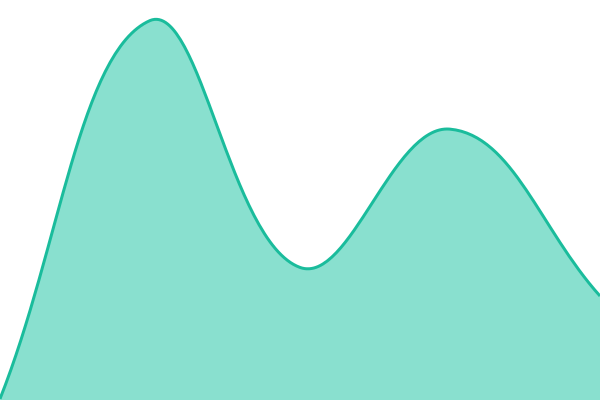
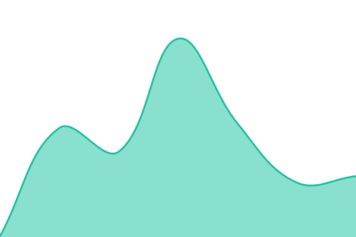
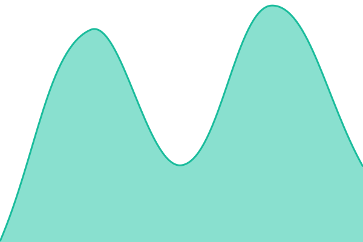

# [📈 Live Status](https://luyasankamalova-a11y.github.io/status): <!--live status--> **🟩 All systems operational**

This repository contains the open-source uptime monitor and status page for [luyasankamalova-a11y](https://luyasankamalova-a11y.github.io/status), powered by [Upptime](https://github.com/upptime/upptime).

With [Upptime](https://upptime.js.org), you can get your own unlimited and free uptime monitor and status page, powered entirely by a GitHub repository. We use [Issues](https://github.com/luyasankamalova-a11y/status/issues) as incident reports, [Actions](https://github.com/luyasankamalova-a11y/status/actions) as uptime monitors, and [Pages](https://luyasankamalova-a11y.github.io/status) for the status page.

<!--start: status pages-->
<!-- This summary is generated by Upptime (https://github.com/upptime/upptime) -->
<!-- Do not edit this manually, your changes will be overwritten -->
<!-- prettier-ignore -->
| URL | Status | History | Response Time | Uptime |
| --- | ------ | ------- | ------------- | ------ |
|  [Главная страница](https://luyasankamalova-a11y.github.io) | 🟩 Up | [glavnaya-stranicza.yml](https://github.com/luyasankamalova-a11y/status/commits/HEAD/history/glavnaya-stranicza.yml) | 

 161ms
     
 | 

<a href="https://luyasankamalova-a11y.github.io/status/history/glavnaya-stranicza">100.00%</a>
    

|  [Кондитерская «Ваниль» (демо)](https://luyasankamalova-a11y.github.io/tort.html) | 🟩 Up | [konditerskaya-vanil-demo.yml](https://github.com/luyasankamalova-a11y/status/commits/HEAD/history/konditerskaya-vanil-demo.yml) | 

 130ms
     
 | 

<a href="https://luyasankamalova-a11y.github.io/status/history/konditerskaya-vanil-demo">100.00%</a>
    

|  [Небанальный Екатеринбург](https://luyasankamalova-a11y.github.io/ekb.html) | 🟩 Up | [nebanalnyj-ekaterinburg.yml](https://github.com/luyasankamalova-a11y/status/commits/HEAD/history/nebanalnyj-ekaterinburg.yml) | 

 208ms
     
 | 

<a href="https://luyasankamalova-a11y.github.io/status/history/nebanalnyj-ekaterinburg">100.00%</a>
    

|  [LifeFlow](https://luyasankamalova-a11y.github.io/lifeflow.html) | 🟩 Up | [life-flow.yml](https://github.com/luyasankamalova-a11y/status/commits/HEAD/history/life-flow.yml) | 

 174ms
     
 | 

<a href="https://luyasankamalova-a11y.github.io/status/history/life-flow">100.00%</a>
    

|  [Продлёнка в телефоне (демо)](https://luyasankamalova-a11y.github.io/prodlenka.html) | 🟩 Up | [prodlyonka-v-telefone-demo.yml](https://github.com/luyasankamalova-a11y/status/commits/HEAD/history/prodlyonka-v-telefone-demo.yml) | 

 87ms
     
 | 

<a href="https://luyasankamalova-a11y.github.io/status/history/prodlyonka-v-telefone-demo">97.20%</a>
    

<!--end: status pages-->

[**Visit our status website →**](https://luyasankamalova-a11y.github.io/status)

## 📄 License

- Powered by: [Upptime](https://github.com/upptime/upptime)
- Code: [MIT](./LICENSE) © [Anand Chowdhary](https://anandchowdhary.com)
- Data in the `./history` directory: [Open Database License](https://opendatacommons.org/licenses/odbl/1-0/)
